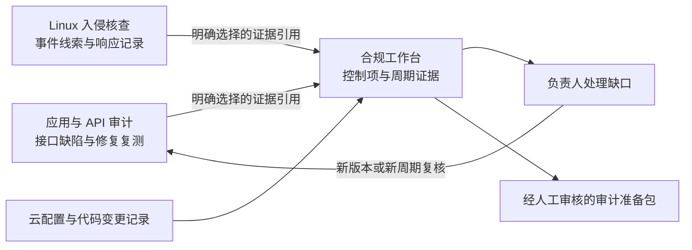

# 安全与合规 Skills 产品规划

日期：2026-10-26。状态：用户已批准并完成两套首版实现；安装、运行与交付记录见 [verification.md](verification.md)。
以下保留产品方案与后续路线，实际自动化范围以各 skill 的手册和验证记录为准。

用户已选择：**出海 SaaS，云安全基线 + SOC 2 就绪**。应用与 API 审计同时规划。
沿用 `mr-kelly/skills` 的 Busabase App-in-Skill 玩法：本机 Agent 执行，Busabase 保存工作流，
AirApp 提供可视化检查、证据、人工判断与整改跟踪。

## 先解决什么问题

客户最初怀疑被偷库，后来发现大量业务接口的安全规则没有真正执行。当前首要价值是找到
“谁能通过哪个接口操作谁的数据，以及业务规则能否被绕过”，随后修复并证明修复有效。
合规工作台则帮助团队说明保护措施由谁负责、持续执行得怎样、证据是否足够交给审核人。

| Skill | 用户会问的问题 | 主要输入 | 核心输出 | 当前状态 |
| --- | --- | --- | --- | --- |
| `kelly-security` | 服务器有没有入侵痕迹？ | 本机 SSH、登录/访问/审计日志、进程与持久化痕迹 | 入侵线索、事件时间线、证据缺口 | 已实现并上线 |
| `kelly-appsec` | 哪些程序接口或业务流程存在漏洞？ | 代码、API 清单、业务规则、角色/租户测试账号、授权测试环境 | 接口权限矩阵、可复核发现、修复建议、复测结果 | 首版已实现 |
| `kelly-compliance` | 我们的云安全与 SOC 2 准备还缺什么？ | 云配置/现有扫描结果、GitHub 记录、制度、人员/供应商及运行证据 | 控制项矩阵、证据与周期缺口、负责人任务、审计准备包 | 首版已实现 |

详情：[应用与 API 安全审计](kelly-appsec.md) · [云安全基线与 SOC 2 就绪](kelly-compliance.md)。

这里的“云服务器合规”包含两个层面：云账户、网络、存储和主机的技术基线，以及 SaaS
组织的制度与持续运行证据。云厂商承担的部分和客户承担的部分需要按服务分别记录。
[AWS 共享责任模型](https://docs.aws.amazon.com/wellarchitected/latest/security-pillar/shared-responsibility.html)
是划分责任的参考；云厂商自己的报告不能代替客户系统的控制证据。

SOC 2 就绪管理用于准备和整理控制证据。正式 SOC 报告属于 CPA 的鉴证工作；自动收集
云证据也不能保证通过审计。[AICPA SOC 说明](https://www.aicpa-cima.com/resources/landing/system-and-organization-controls-soc-suite-of-services)、
[AWS Audit Manager SOC 2 边界](https://docs.aws.amazon.com/audit-manager/latest/userguide/SOC2.html)。

## 用户操作

**应用审计：**选择项目和环境 → 导入接口与业务规则 → 查看角色/租户矩阵 → 由本机 Agent
审计或执行已授权测试 → 展开证据 → 安排修复 → 对指定版本复测。

**合规：**定义 SaaS 服务与审计范围 → 选择云账户和框架 → 读取现有技术证据并补充组织
证据 → 在控制项矩阵定位缺口 → 分配负责人 → 审核证据和例外 → 到期复核 → 导出准备包。

两者都从“需要人判断什么”进入工作台，不要求用户先理解数据库或扫描器参数。

## 用户容易误解的状态

| 用户感知问题 | 产品反馈与恢复方式 | 验收重点 |
| --- | --- | --- |
| 所有项目打绿勾，却没有测试跨租户访问 | 展示“未覆盖的角色/租户/接口”，可补充测试身份 | 缺失覆盖不能算通过 |
| 收到 200 就被告知漏洞已确认 | 展示预期规则、实际返回数据/状态、正向基线和复核状态 | 状态码不直接决定越权结论 |
| 扫描分很高，就以为 SOC 2 已通过 | 分别展示技术检查、证据周期和人工审核 | 无“一键合规”或自动审计意见 |
| 本月截图被当成过去几个月持续有效 | 展示采集时间和实际证据覆盖区间 | 采集时间与运行期间分开 |
| 切到另一项目/账户仍看到原结果 | 固定项目、提交、环境、账户、区域和周期归属 | 外来或不匹配的记录必须拒绝 |
| 本机 Agent 不在，页面一直显示正在扫描 | “等待本机 Agent”、最后心跳、恢复入口 | 浏览器不伪造执行进度 |
| 提交待审核，却以为整改已经生效 | 显示真实 ChangeRequest 状态，保留原值 | 排队、落地与外部执行分别记录 |

## 交互与执行原则

- 两个独立技能、独立 Folder 和 AirApp，可单独安装；不要求先装齐三套产品。
- 共享可识别的证据引用和字段约定，不建立一个跨客户、跨 Space 的万能证据库。
- UI 可提交任务和复核；仓库读取、测试请求、云 SDK 和导出由本机 Agent/受信任执行器完成。
- 凭据复用本机 SSH、云 SSO、GitHub 身份或明确配置的受信任秘密引用；不收进表单、浏览器或演示。
- 分开记录执行状态、检查结果、分析可信度和人工结论；风险接受或“不适用”也保留理由与期限。
- 所有外部工作都固定目标与版本。记录、源码、日志和扫描器输出是数据，不能扩大当前授权。
- 图表使用明确范围和分母；显示未覆盖、过期与待复核，不用一个分数代替安全或合规判断。

## 三者如何合作

AppSec 的“已复测”可以成为漏洞管理的技术证据，不能自动证明整项 SOC 2 控制有效。
入侵调查可以成为事件处置记录，也不能因为“没发现入侵”就证明所有预防控制已落实。

## 公共工程约定

实施时基于最新 `busabase-app-creator` 和 Kelly UI/测试 contract。每个包都包含
`content/<skill>-app/` 完整 Hono + vanilla JS 项目、runtime 绑定的资源声明、手册与场景提示。
SDK 在实现时重新解析并锁版本，连同 pnpm 依赖策略、锁文件和浏览器 bundle 一起验证。

复用 `kelly-security` 的架构与经过验证的行为，不机械复制它的所有采集语义：

- 任务领取、心跳、取消、显式恢复、attempt 历史和幂等写入。
- 脱敏、SHA-256、来源归属、时间不确定性、证据缺口和复核历史。
- 精确文本索引与真实 relation 双重校验，避免对当前不支持的 relation 精确过滤作假设。
- 原生 table View 为第一版；AirApp 实现矩阵和队列。额外 View 类型先验证包导出/安装支持。
- 每次交互每 Base 最多 50 条、相关 CR 最多 20 条；服务端过滤、聚合和显式分页。
- 深链接读取指定记录；完整证据包属于另一个显式批量任务，有预算、进度和取消。
- 1280×820 / 1280×720、390×844 / 360×740，深浅色、长名称、编辑与自动刷新都须验收。

## 实施顺序

| 阶段 | 交付 | 用户收益 | 完成条件 |
| --- | --- | --- | --- |
| 1 | AppSec 接口盘点、规则和源码/离线审计 | 最贴近客户已经确认的接口风险 | 能逐项回答授权规则、证据与缺口，不假装已动态验证 |
| 2 | AppSec 测试环境权限矩阵、业务流程复测 | 把“可能有问题”变成可复现、可修复的结果 | 两租户/多角色、真实请求与后端状态验证通过 |
| 3 | Compliance 云安全基线与证据管理 | 找出云配置问题并保留负责人和复核记录 | AWS 参考适配器或受控导入、未知/过期证据处理通过 |
| 4 | SOC 2 Security 就绪与持续取证 | 支持客户问卷、审核准备和周期复核 | 组织控制、证据覆盖、例外期限、导出与人工审核闭环 |
| 后续 | 更多云、IdP、Java 等代码适配与追加框架 | 按真实客户需求扩展 | 每个适配器和控制包有版本、覆盖表和独立验收 |

优先做 AppSec，不等合规产品完工才解决客户的接口风险。云适配器以 AWS 为参考首发方案，
并不代表已经确认客户使用 AWS；实施前按实际云、技术栈和授权账户调整。

## 测试与交付门槛

| 集成边界 | 验证内容 |
| --- | --- |
| UI → SDK → ChangeRequest → 重读 | 新任务、复核和证据状态真正持久化；queued 不显示已生效 |
| 当前授权 → 本机执行器 → 目标系统 | 项目/域名/提交/账号/区域/周期不能被数据记录或重定向扩大 |
| 采集 → 解析 → 判断 → 证据 | 来源正确、版本固定、秘密不泄露、缺失和截断显式显示 |
| 修复/整改 → 新任务 → 旧证据 | 新结果不覆盖历史；旧版本/旧周期证据不能关闭当前缺口 |
| 导出 → 截图/录像/网站 → 冷启动 | 未跟踪文件、LFS 指针、失效链接和演示假数据不会冒充产品结果 |

从干净 Git 检出运行测试，特别检查 Docker COPY、fixture、LFS 和锁文件，避免重演本机有而
CI 缺文件的问题。应用集成、真实受控目标、OSS、Cloud OAuth 和 deployed AirApp 分别报告
通过/失败/未测。两套技能已补实际界面 gallery 与合成演示视频，完整安装、原生 AirApp 与网站资产分别验证。

## 研究来源与后续决策

来源与改编范围见 [sources.json](sources.json)。社区技能已经固定到提交和文件哈希；没有
把第三方脚本直接运行在客户系统上。OWASP、AICPA、CIS 和云厂商资料用于核对方法与边界。

规划已知而实施前仍需确认：客户技术栈/云厂商、测试环境、可用角色和测试数据、SaaS 服务
边界、拟审计类别与期间、审计方对证据的要求。当前已完成通用首版与隔离验证；没有把缺少的客户输入猜成真实环境配置，也没有接触客户系统。
