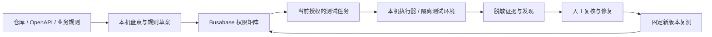

# Kelly AppSec：应用与 API 安全审计

状态：待实施产品方案。名称建议 `kelly-appsec`，中文“应用与 API 安全审计台”。

## 用户价值

帮助客户确认每个接口是否执行了正确的身份、权限、租户和业务规则，并把发现推进到可验证
的修复。用户最终看到的是“哪条规则被违反、影响什么、证据在哪里、哪个版本已修好”。
这直接回应客户提到的业务流程与接口风险，也减少只有扫描告警却无法分派给开发的挫败感。

首版的原则是：服务端依据可信身份与业务状态执行规则，客户端提交的用户、租户、角色、
价格或状态值不能自行获得权限。具体允许什么，由业务规则和授权策略决定；公开分享、
委托访问等合法场景也要能表达。

## 用户故事与操作

1. 我选择仓库和测试环境，导入 OpenAPI/接口清单，希望看清盘点来源、提交版本和遗漏。
2. 我标明角色、租户、对象归属和关键流程，希望系统先列出预期权限，再判断实现。
3. 我选中“订单”“导出”“成员管理”等流程，查看“接口 × 身份/规则”矩阵。
4. 我让本机 Agent 审查源码或在已授权测试环境验证；没有测试凭据时，清楚显示未动态验证。
5. 我打开一个发现，看规则、代码位置、正向基线和脱敏请求/响应或后端状态证据。
6. 我分配修复，查看补丁建议；修复后对指定提交/部署再次测试，保留旧结果。
7. 我导出按风险和业务流程组织的报告，把已核实证据选择性引用到合规工作台。

## 用户感知问题与体验要求

| 问题 | 用户会说什么 | 体验目标与恢复 |
| --- | --- | --- |
| 只看前端按钮，没有查后端 | 隐藏了按钮是不是就安全了？ | 每项关联真正的服务端入口和完整鉴权链 |
| 不知道正常情况下谁能访问 | 扫描器怎么知道这数据不能公开？ | 先记录预期策略；缺业务规则就待确认 |
| Swagger 没有的接口被遗漏 | 老版本和内部接口查了吗？ | 区分文档、源码、已提供流量，标明未覆盖入口 |
| 一个 200 被判成越权 | 这不是正常的公开分享吗？ | 对比业务策略、响应内容及对象归属，支持正常解释 |
| 修复后告警被手动关闭 | 真修了吗，哪个环境？ | 固定修复提交/部署，只有匹配范围的复测证据能验证 |
| 切项目后结果串了 | 这是哪个客户、哪个分支的？ | 项目、源提交、运行目标、测试身份均可追溯 |

## 首版检查包

以 [OWASP ASVS](https://asvs.owasp.org/) 的可验证要求和
[OWASP API Security Top 10](https://api-security.owasp.org/editions/2023/en/0x11-t10/) 为索引，
首发采用 ASVS 5.0.0 / API Top 10 2023 的明确版本引用，后续升级不覆盖历史判断。

| 检查族 | 首版重点 | 判断需要什么 |
| --- | --- | --- |
| 接口与信任边界 | 路由、中间件、服务层、敏感数据去向、旧版本与批量/导出接口 | 来源和提交；全局鉴权也必须追踪，不能只 grep 局部代码 |
| 身份与会话 | 匿名调用、过期/撤销身份、服务端会话、服务账号适用范围 | 正常登录基线、实际策略和受控测试身份 |
| 对象与租户授权 | 横向越权、跨租户、列表/搜索/附件/异步任务结果归属 | 两个测试租户、各自数据及预期允许关系 |
| 功能与字段授权 | 普通用户调用管理动作、受限字段写入、批量赋值、响应多给字段 | 角色策略、字段读写规则和实际响应/状态 |
| 业务完整性 | 金额与数量由服务端计算、审批/支付/验证步骤、重复提交、幂等与状态转换 | 业务状态机和测试资源；不把所有顺序变化都判为漏洞 |
| 回调与第三方边界 | 签名/来源、重放、事件与对象绑定、回调金额/状态核验 | 供应商沙盒或可控 mock 和可核对的业务状态 |
| 输入与敏感能力 | 注入、上传/下载、任意 URL 获取、路径/文件边界 | 代码路径或隔离测试目标；不从扫描器名称推断已利用 |
| 滥用与资源限制 | 登录/找回、邀请/优惠、导出/查询成本、批量与频率 | 应用承诺、风险场景和明确请求预算 |
| 依赖/秘密/配置 | 已知依赖告警、明显秘密引用、错误信息、调试接口 | 解析版本/配置与可达性；不自动安装或运行客户仓库脚本 |

对象标识是 UUID 不代表授权正确；返回 401/403/404 也不自动证明所有数据路径正确。
[OWASP BOLA](https://api-security.owasp.org/editions/2023/en/0xa1-broken-object-level-authorization/)
强调按对象和动作验证权限。业务敏感流程还需要结合滥用方式检查，参考
[OWASP 敏感业务流程](https://api-security.owasp.org/editions/2023/en/0xa6-unrestricted-access-to-sensitive-business-flows/)。

### 首发适配范围

- 支持显式导入 REST/OpenAPI、项目代码和已有扫描报告；首个源码适配围绕 Node/TypeScript。
- 客户实际框架决定优先支持的路由/中间件形态；Next/Hono/oRPC/tRPC、Java/Spring 等不因
  存在接口名称就宣称已经完整审查。无法解析的部分保留手工规则与未覆盖标记。
- GraphQL、gRPC、WebSocket、Java/其他语言的深入适配按客户需求排入后续；首版可登记
  对应入口，不宣称已覆盖其特有执行/字段授权语义。
- 多项目可管理，每次动态测试固定一个项目、一个测试部署和一份策略快照。

## UI 方案

左侧：总览、项目与接口、业务规则、权限矩阵、发现与修复、运行记录；帮助与设置放底部。

**总览：**“本次还有哪些高影响接口需要核实”，展示已确认问题、待补业务规则、未测试身份。
数字分别说明已盘点/已执行/已复核的分母，不输出“系统 98% 安全”。

**核心矩阵：**行是接口或业务动作，列是匿名、同租户普通用户、另一个用户、跨租户用户、
管理员、已撤销身份等场景。每格同时有预期策略和本次结果，点开是代码与证据详情。

**发现详情：**用户故事 → 被违反的规则 → 来源和复现 → 影响/可信度 → 替代解释 → 修复建议
→ 负责人 → 复测版本与结果。手机采用列表/矩阵分组 → 详情 → 固定复核操作栏。

空状态可导入清单或新增规则；加载显示来源和进度；失败区分权限不足、目标不匹配、解析不
支持和连接问题；刷新恢复任务；正在编辑备注时不被自动刷新覆盖。

## 运行流程与数据图

建议七个 Base：

| Base | 关键字段与关系 |
| --- | --- |
| projects | 项目、负责人、仓库引用、声明环境键、范围/设置 Doc 引用 |
| endpoints | project、method/path 或动作键、来源、代码定位、源提交、业务流程 |
| rules | project、业务规则、主体/对象/动作/条件、规则版本、负责人、确认状态 |
| runs | project、commit/deployment、环境键、策略快照、身份引用、请求预算、claim/heartbeat |
| checks | run、endpoint、rule、预期结果、采集状态、实测结果、attempt、覆盖缺口 |
| findings | check、evidence 引用、严重度/可信度、复核、修复/复测状态、负责人 |
| evidence | check、来源定位、脱敏摘要、采集时间/哈希、对象与目标快照、保留策略 |

另外有设置/业务说明 Doc、证据与报告 Drive、同名 skill 手册及 AirApp。七个 Base 是建议
资源图，实施蓝图再审定字段；常规记录用原生 table，跨资源分析用 AirApp。真实 relation
与独立文本索引同步校验。证据原件按客户保密策略留在本机或已选受控存储。

## 状态与执行边界

**执行：**草拟 → 已请求 → 等待本机 Agent → 执行中 → 完成 / 部分完成 / 失败 / 取消。
**检查：**允许符合预期 / 拒绝符合预期 / 违反规则 / 未验证 / 缺前提 / 不支持。
**发现：**候选 → 待复核 → 已确认 / 正常解释 / 证据不足 → 待修复 → 待复测 → 已验证修复 / 重开。
采集完成、问题确认、代码合入和复测通过是不同事件。

- 默认可先做源码/离线审计。动态测试需要现有会话授权和明确测试资源，不能由数据库记录
  或抓到的 URL 扩大。生产系统仅在单独确定的方法、测试数据和影响范围内验证。
- 不能因为是 GET 就假定无副作用；支付、邮件、短信、删除和第三方动作只用隔离数据/沙盒。
- 不默认执行隐蔽接口爆破、口令破解、大规模枚举、压测或针对真实客户对象的探测。
- 建议动态任务每批至多 5 个接口/动作、100 次请求、并发 2、每来源 1 次/秒；到限标记未完，
  不偷偷提高预算。重定向、目标来源和测试对象变化时重新核对范围。
- 测试令牌只在本机执行边界解析；证据去除 Authorization、Cookie、秘密、个人数据和不必要
  业务内容，保留足以证明对象归属/状态变化的最小信息。
- 检查成功标准包含预期数据/字段/数据库状态/外部 mock 事件；HTTP 200 单独不能确认越权。
- 源码线索与动态证据分别标注。未跟完整的全局中间件或间接授权链不能写“确认未鉴权”。
- 第一版提供修复建议和补丁草案；实际改代码、提 PR、部署或再次操作第三方需要相应任务范围。

## 测试计划

| 用户行为 / 故障 | 预期可见结果 | 持久化与后端证明 | 类型 |
| --- | --- | --- | --- |
| A 读自己的订单；A 读 B 的订单 | 正向成功；按业务策略拒绝另一个对象 | 对象内容不泄露、无越权写入 | 隔离 API 集成 |
| 公开分享链接返回 200 | 不自动判越权 | 策略明确允许，返回字段在允许范围 | 策略 + 动态 |
| 普通用户修改 role/tenant/price | 显示实际执行的服务端规则 | 受限字段/金额未按不可信值改变 | 业务流程集成 |
| 直接跳到支付/审批后的动作 | 明确拒绝非法状态或产生经证实发现 | 数据状态和 mock 外部动作均可核对 | 状态机集成 |
| 仅找到“看似无中间件”的局部代码 | 候选待查，不确认漏洞 | 可追踪全局/服务层授权链 | 源码适配 |
| 无 B 租户账号、接口仅在文档出现 | 显示缺前提/未动态覆盖 | 不伪造测试或默默缩小分母 | 单元 + UI |
| 域名重定向到范围外地址 | 任务停止并说明 | 无外部请求发出 | 执行器集成 |
| 旧提交的通过结果拿来关闭新提交问题 | 拒绝或待复测 | 目标版本/规则快照一致才验证修复 | 服务层 + UI |
| 刷新、Agent 失联、双重领取、取消 | 恢复已完成记录、失联可恢复、无重复副作用 | claim、幂等、attempt 与取消检查 | Busabase + runner |
| 报告/源码含脚本或秘密 | 安全文本和脱敏证据 | 不执行源码安装脚本，不泄露秘密 | 单元 + 浏览器 |

完整集成链包含 UI → SDK → CR → 重读、run → 本机授权 → 隔离 API → 后端状态、发现 → 修复
版本 → 复测证据，以及报告导出 → 明确的分页/截断说明。四种视口验证矩阵选择、深链接、
编辑保护、复核和返回。OSS、Cloud OAuth 与 deployed AirApp 另列验收。

## 分期与验收

| 优先级 | 范围 | 可验收结果 |
| --- | --- | --- |
| P0 | 项目/接口盘点、规则、源码和离线报告、可视化矩阵、发现/证据 | 每项能回答来源、预期规则和未覆盖部分；源码线索不冒充动态发现 |
| P0 | 两租户/多角色测试环境的授权验证，选定业务状态机案例 | 受控真实 API 可复现授权正确与漏洞案例，正向基线也通过 |
| P1 | 修复建议/补丁草案、精确版本复测、CI 报告导入 | 问题仅由新版本对应证据推进，历史与正常解释保留 |
| P1 | 可控 ZAP/其他扫描器结果导入、依赖告警去重 | 不以扫描器零发现替代业务/授权检查；来源和规则版本可追溯 |
| P2 | 更多语言/协议、跨服务异步流程、合规证据引用 | 每种能力有独立适配器、覆盖与限制，不静默扩展测试范围 |

## 可复用来源与改编

社区技能采用 `mukul975/Anthropic-Cybersecurity-Skills@54a798831d2266a3ca61ce68a7acb80b81160d57`，
Apache-2.0，具体链接/哈希见 [sources.json](sources.json)：

- `conducting-api-security-testing`：接口盘点、身份和授权维度；不继承默认探测所有隐藏接口、
  密码破解、高速请求或将 introspection 一律视为漏洞等做法。
- `testing-api-for-broken-object-level-authorization`：双身份/对象归属对比；改为业务策略和实际
  数据/状态验证，不使用“200 就存在漏洞”或按 UUID 自动降低风险。
- `testing-for-business-logic-vulnerabilities`：流程与规则建模、状态/幂等检查；将写入和第三方
  副作用放入授权沙盒，不直接套用生产交易示例。

OWASP 官方资料负责核对判定原则，社区技能提供可改编流程。工具选型和具体版本在实现时
验证，授权矩阵与业务规则仍是本产品自己的核心数据。
