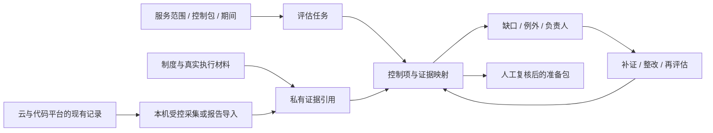

# Kelly Compliance：云安全基线与 SOC 2 就绪

状态：已按此方案实现首版 `kelly-compliance`。用户已选目标：**出海 SaaS**。实际自动化能力、验证与限制见 [交付记录](verification.md)。下列完整场景同时作为持续演进的验收方向。
名称建议 `kelly-compliance`，中文“云安全与合规准备台”。

## 用户价值

帮助 SaaS 团队回答企业客户和审计准备中的具体问题：哪些资产在范围内、控制由谁负责、
哪些技术设置存在问题、证据覆盖哪个期间、下一步谁来补齐。团队能持续维护这些事实，
而不是到客户问卷或审计前临时收集截图。

首版包含两个相互关联的工作面：**云安全基线**和 **SOC 2 就绪与证据管理**。
技术检查的结果可以支撑控制项，但云配置正常并不自动证明人员、流程和持续运行都有效。
[AWS Audit Manager 官方说明](https://docs.aws.amazon.com/audit-manager/latest/userguide/SOC2.html)
也明确区分自动收集证据与程序性控制、合规判断和审计结果。

正式 SOC 报告属于 CPA 的鉴证工作，本产品提供准备材料和可追溯记录。Type 1 关注一个
时点，Type 2 关注一个期间；期间、类别、取样与所需证据由实际业务和审计安排确定，
不在产品中硬编码一个“跑满若干天就能通过”的期限。
[AICPA SOC 说明](https://www.aicpa-cima.com/resources/landing/system-and-organization-controls-soc-suite-of-services)、
[AICPA 报告复核工具](https://assets.ctfassets.net/rb9cdnjh59cm/3xbcLlNc5rd72So4nQpNIk/7a3e8e5945c78c35fc5e116859b96e6a/SOC_2_Report_%C3%82_Review_Checklist.pdf)。

## 用户故事与操作

1. 我定义面向客户提供的 SaaS 服务，选择环境、云账户/区域、外包服务和拟审核期间，避免
   把“整个公司所有东西”和“一台服务器”混成同一个范围。
2. 我导入已有云报告或授权本机读取配置，希望看见哪些账户/区域真的被覆盖，以及哪些没权限。
3. 我选择控制包，查看“控制项 × 资产/期间”的矩阵；技术检查与制度/运行证据分开显示。
4. 我打开缺口，看到为什么需要证据、负责人、应提供的材料、有效期和具体补救方式。
5. 我提交真实证据或引用私有原件，让负责人审核；新文件不会自动抹掉旧缺口或伪造过去的运行。
6. 我跟进访问复核、离职回收、代码变更、演练等周期性工作，到期后重新检查。
7. 我按指定范围导出准备包；审核人能追溯来源、期间、完整性、例外和仍然缺失的部分。

## 用户感知问题

| 问题 | 用户会说什么 | 产品行为 |
| --- | --- | --- |
| 云厂商有 SOC 报告，自己系统就算通过 | AWS 合规，是不是我们也合规？ | 分清继承、共同和客户自有责任，保留供应商报告范围 |
| 只有当前快照，没有运行期间 | 今天设置对了，前几个月怎么办？ | 展示采集时间、事件期间和控制执行频率，不回填历史 |
| 没开 Config/没给权限就显示绿 | 为什么没有扫描到问题？ | 未配置、无权限、不支持、缺数据分别显示 |
| 只扫描一个区域却给公司总分 | 其他区域和账户查了吗？ | 显示范围清单、遗漏与原因，统计不隐去缺口 |
| 有一份制度文件就显示控制有效 | 文件从来没人执行也行吗？ | 设计/文档、实际执行证据、人工复核分别记录 |
| 上次证据过期但仍算完成 | 已经离职的人还有权限吗？ | 按声明周期过期，重新产生缺口与负责人任务 |
| 风险接受被当成整改完成 | 接受风险之后就不用修了？ | 保留失败结果、补偿措施、接受人、期限与残余风险 |

## 首版范围

### 云安全基线

首批参考适配器按 AWS 设计，具体云在实施前依据客户环境确认；已有 Prowler/云平台报告
导入可先交付，不要求用户为了试用立即配置全部云权限。

检查围绕可解释的基线项目展开：

| 检查族 | 需要验证的事实 | 证据与限制 |
| --- | --- | --- |
| 资产范围 | 账户、区域、环境、资源类型、负责人 | 发现范围与排除项都保留；全球服务与区域服务分别处理 |
| 管理身份与授权 | 强认证/联邦身份、管理员权限、长期凭据与访问复核 | 不只检查 IAM 用户而遗漏 SSO；适用规则依据身份模型 |
| 网络暴露 | 安全组、管理端口、数据库/服务公开可达配置 | 配置风险与实际攻击事件分开，不主动连接任意资源 |
| 存储与数据保护 | 对象存储公开策略、加密设置、密钥配置与访问边界 | 区分业务有意公开的数据；有加密不代表访问控制正确 |
| 日志与监测 | CloudTrail/现有审计、记录范围、保留与告警配置 | 记录启用不证明过去一直启用；缺历史需标明 |
| 备份与恢复 | 备份策略、执行结果、恢复测试记录 | 备份任务成功不等于恢复演练成功 |
| 漏洞与主机基线 | 现有漏洞/补丁/系统基线报告和处理时限 | Linux 入侵核查无异常不能代替主机基线检查 |
| 变更与配置漂移 | IaC/代码变更、配置差异、审批/测试记录 | 以实际时间顺序和当时规则判断，不以当前设置倒推过去 |

根据云服务和版本参考 [CIS Benchmarks](https://www.cisecurity.org/cis-benchmarks) 与厂商
安全基线。控制包记录标准版本、扫描器版本、支持清单和映射审核状态；不会把社区技能中
旧版 CIS 编号直接套到新版本，也不会声称一个工具覆盖全部标准。

### SOC 2 就绪与持续取证

首版围绕 Security 相关控制准备，按实际服务承诺再补 Availability、Confidentiality 等类别。
以 [AICPA 2017 TSC（2022 修订关注点）](https://www.aicpa-cima.com/resources/download/2017-trust-services-criteria-with-revised-points-of-focus-2022)
作版本化参考。下表是本产品拟提供的控制工作模板，不等于官方条目清单或固定审计程序。

| 控制工作面 | 技术证据 | 需要组织提供/审核的证据 |
| --- | --- | --- |
| 服务边界与责任 | 系统/数据流和资产范围 | 客户承诺、负责人、供应商/分包服务范围 |
| 风险识别与处理 | 已核实漏洞和配置风险 | 风险评估、处理决定、复核与残余风险 |
| 身份与访问 | 账号/角色/权限、强认证 | 入离职记录、访问申请和周期复核 |
| 变更管理 | PR、CI、部署和回滚记录 | 当时要求的授权与审核、例外或紧急变更说明 |
| 运行与漏洞处理 | 日志、告警、扫描和整改/复测 | 事件流程、处理时限、实际执行记录 |
| 备份与连续性 | 备份结果、恢复测试 | 业务恢复目标、演练与改进跟进 |
| 人员与制度 | 可引用的系统记录 | 制度版本、批准、适用人员、培训/确认与执行证据 |
| 供应商与客户数据 | 云/第三方配置、合同和报告元数据 | 供应商评估、报告范围、保密承诺及客户责任 |

控制项具有目的、执行方法、负责人、频率/期间、证据要求和复核方式。小团队和大团队可以
采用不同但可解释的实施方式；不强制从模板生造安全部门、委员会或所有控制统一的频率。
原始标准文本按各自许可使用，社区 skill 的 Apache-2.0 不覆盖 CIS 或 AICPA 的标准内容。

## UI 方案

左侧：就绪总览、云账户与资产、控制项矩阵、证据中心、缺口与例外、评估与导出；帮助与
设置放底部。延续 Kelly 的可读深浅色与手机布局。

**就绪总览：**优先显示“本期缺什么、谁来补、哪项快到期”，分别统计范围覆盖、缺失/过期
证据、待人工复核和高优先级技术问题。对外不显示“获得 SOC 2”或以扫描百分比替代审计意见。

**双矩阵：**技术面按“资产 × 检查项”，审核面按“控制项 × 证据期间/执行实例”。每格能
展开原始来源、实际覆盖、当前结果、责任归属与审核记录。手机使用可筛选分组卡片和详情。

**证据中心：**以控制目的组织材料，同时展示缺失、过期、范围不匹配、待审核。允许一个
证据被多项控制引用，但每项映射都单独保留适用性与审核，避免复制文件或一份材料无条件通用。

**缺口处理：**明确的负责人、截止时间、补偿措施、整改记录和复核结果。等待审批与真正
完成分开；正常例外和风险接受不会让失败的技术检查变成绿色。

空项目可先建范围或导入报告；无权限提供所缺的具体读权限；缺云服务时可用已有报告和
人工证据。刷新恢复已采集记录，版本不兼容、API 限流和部分区域失败有可见恢复路径。

## 运行流程与资源图

建议八个 Base，分开保持数据生命周期；不把不同期间和所有证据塞进一个 JSON 列：

| Base | 关键字段 |
| --- | --- |
| programs | SaaS 服务、环境/云账户/区域范围、框架版本、类别、时点/期间、负责人、范围版本 |
| resources | program、provider/account/region/resource-key、资产类型、业务角色、来源与发现时间 |
| controls | program、内部控制键、外部要求/版本引用、目的、方法、owner、频率、证据需求、设计状态 |
| assessments | program、范围快照、期间、适配器/规则版本、任务状态/claim/heartbeat、覆盖与汇总 |
| evidence | 来源/位置/哈希、采集时间、原始事件期间、敏感级别、保留/有效期、私有文件引用 |
| evidence-links | assessment、control、evidence、资源/周期适用范围、映射版本、复核状态/理由 |
| issues | assessment/control、缺口或技术问题、严重度、负责人、期限、整改与复核记录 |
| exceptions | control/issue、适用范围、理由、补偿措施、接受人、有效期、复核/撤销 |

另外有控制说明/范围/制度 Doc、受限证据/报告 Drive、skill 手册与 AirApp。八个 Base 是建议
边界；实施前审定字段和权限。各 Base 有原生 table 和面向人的场景提示，AirApp 合成矩阵与
优先队列。证据原件优先留在客户选定的私有存储，Busabase 保存必要元数据与脱敏内容。

## 状态与判断

分开存储以下维度，不能由一个布尔值驱动全部绿色状态：

- 采集：未开始、等待 Agent、执行中、完成、部分完成、无权限、缺配置、不支持、失败、取消。
- 技术检查：符合已声明规则、违反规则、未知、需人工核对、不适用。
- 证据：缺失、已收集、待审核、可支撑此控制、范围/周期不匹配、过期、已被新版本替代。
- 就绪：未实现、已设计、待运行证据、待复核、在声明范围内证据就绪；不等于审计通过。
- 缺口：待分派、处理中、待验证、已验证关闭、重开；例外另有接受和到期状态。

Type 2 的历史覆盖是控制执行和证据来源的事实。采集于期间之后的真实日志不必自动作废，
但必须保留实际事件期间并验证来源；今天新增的制度或配置不能冒充过去已经执行。
点时快照不自动扩成整段期间。证据时效、执行频率和抽样方式按具体控制设置并由负责方确认。

## 执行、权限与成本

- 默认先导入报告/文件，再按明确账户和区域做现有数据的受控读取；云 SSO/短期角色留在本机。
- 本机验证真实云身份与任务范围。账户、区域、控制版本或报告来源改变时，不静默沿用旧授权。
- 不继承社区样例里的 `securityhub:*`、`config:*` 等宽权限。逐适配器声明所需操作与敏感输出。
- 不自动启用 Security Hub、Config、GuardDuty，不修改 IAM/安全组/存储策略，不启动付费
  服务或修复资源。报告生成等非纯读取操作也要单独说明影响，不能因 API 名称而视作只读。
- 云厂商支持和前提会变化，运行时核对具体版本与启用状态；缺前提就显示缺配置，不借机补建。
  [Security Hub CSPM 前提](https://docs.aws.amazon.com/securityhub/latest/userguide/securityhub-setup-prereqs.html)。
- 列表页每 Base 最多 50 条，相关 CR 最多 20 条；账户/资源大扫描是显式任务，分页、限流、
  检查点和预算独立，不藏在页面加载里。建议首版每任务至多 2 个账户、5 个已声明区域和
  500 个资源，达到上限明确显示剩余范围，可分批继续。
- 证据中的人员信息、私有仓库、合同和安全配置按敏感级别处理。前端隐藏不是访问控制，
  Busabase 节点权限与原始存储 ACL 都要通过实际权限测试。
- 第一版不把整改执行纳入审计采集器。若以后加入实际云变更，另建受控执行路径与审批、
  回滚、验证，并相应提升风险分类。

## 测试计划

| 用户行为 / 故障 | 预期可见结果 | 持久化与边界证明 | 类型 |
| --- | --- | --- | --- |
| 一个账户在某区域被拒绝 | 显示区域缺口，不计为检查通过 | 错误和范围保留，其他批次可继续 | 云适配集成 |
| Security Hub/Config 未启用 | 明确缺配置，可导入已有证据 | 无 enable/write 调用，无新增付费资源 | SDK fake + 受控云 |
| 联邦身份存在但 IAM 用户列表为空 | 不误判“没有管理员风险”或所有人无 MFA | 身份模型未覆盖就待补证 | 身份适配 |
| 使用点时截图支撑三个月周期 | 证据期间不足，控制仍待补证 | 不扩展时间覆盖，不自动更改就绪状态 | 判断引擎 + UI |
| 期间后导入了真实历史日志 | 展示采集时间与事件期间，待核对来源 | 不因上传时间机械判假，也不凭声明自动通过 | 证据集成 |
| 同一文件用于两项控制 | 两条独立适用/审核映射 | 文件哈希复用，映射状态互不串联 | Busabase |
| 风险接受到期、控制证据过期 | 重新进入待处理，保留旧决定 | 期限驱动状态，失败检查不变绿 | 时钟测试 + UI |
| 新框架版本复用了旧编号 | 提示映射待审，不自动迁移结论 | 标准/适配器/映射版本一致性 | 单元 + 导入 |
| 多页扫描取消或中断 | 保留检查点和已采集来源，剩余为未覆盖 | 幂等恢复，不把部分数据当全量 | runner + 集成 |
| 导出者无权读取 HR 附件 | 缺权限项明确列出，不泄露内容 | SDK/存储授权阻止读取，导出不越权 | 权限端到端 |

集成必须验证 UI → CR → 重读、账户身份 → 采集器 → 原始响应 → evidence → control mapping、
缺口 → 整改证据 → 新评估、权限 → 文件 → 导出，以及跨项目/账户不串数据。重复导入与
并发任务不能重复制造资产和证据。四种视口验证过滤、周期切换、证据详情、备注和导出。

## 分期与验收

| 优先级 | 范围 | 可验收结果 |
| --- | --- | --- |
| P0 | 服务范围、控制项与资产、证据导入、缺口/负责人、可视化矩阵 | 不接云也能完整管理一个真实就绪项目；演示不冒充真实采集 |
| P0 | 有限 AWS 基线读取与已有 Prowler/Security Hub 结果导入 | 只读操作、版本兼容与范围可核对；未知、限流和缺权限可恢复 |
| P1 | GitHub 变更证据、访问复核/入离职/供应商/制度材料、期间管理 | 覆盖组织与技术证据，能辨认当前快照不足以证明持续执行 |
| P1 | 到期复核、例外、整改验证、审计准备包 | 每条材料有来源、期间与审核，缺口与导出截断明确 |
| P2 | 更多云/IdP、追加类别、跨框架映射和客户问卷 | 每种集成和映射独立声明版本/覆盖；不混称等保、GDPR 或 ISO 已满足 |

第一版聚焦云基线和 SOC 2 Security 就绪；等保、GDPR、ISO 27001 等作为后续单独控制包，
按真实市场与专业要求再规划，不把不同制度的要求混成同一张“合规通过表”。

## 可复用来源与改编

社区技能固定到 `mukul975/Anthropic-Cybersecurity-Skills@54a798831d2266a3ca61ce68a7acb80b81160d57`，
链接/哈希见 [sources.json](sources.json)：

- `performing-soc2-type2-audit-preparation`：控制责任、证据和周期流程；重做真正分页、时间
  顺序和适用性判断。某次存在 approved review 不等于合并前有效审核，也不固定审计期间。
- `auditing-cloud-with-cis-benchmarks`：账户/资源基线、结果解释和整改跟踪；不复制旧版本为
  “最新版”，不附带自动删密钥、改加密或新建日志服务的命令。
- `implementing-aws-security-hub-compliance`：整合现有发现的思路；不照搬其部署、宽权限与
  自动整改路径，依据当前 AWS 文档核对采集前提。

Prowler 等作为可选采集/导入引擎；Busabase 工作台负责范围、业务责任、证据就绪和处理
闭环。扫描工具的原始结论保留来源，组织控制和审计判断仍由明确的人员复核。
